# Erka

**A fast desktop workbench for running many coding-agent CLIs — Claude Code, Codex, OMP and plain shells — across many projects at once.**

Agents live in a background session daemon, so switching projects, closing the window or a UI crash never stops them. Only what is on screen is rendered: 20 agents in the background cost the UI almost nothing, and switching between projects takes ~30 ms.

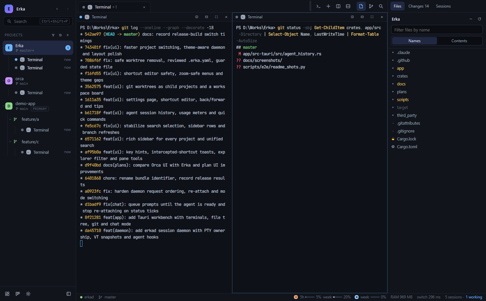

- **Windows 10 1809+ / 11** (tested) and **macOS 12+** (built in CI).
- Tauri 2 · SolidJS · xterm.js (WebGL) · CodeMirror 6 · a Rust session daemon (`erkad`) built on `alacritty_terminal` and ConPTY / Unix PTYs.

---

## Contents

- [Features](#features)
- [Screenshots](#screenshots)
- [How it works](#how-it-works)
- [Performance](#performance)
- [Install](#install)
- [Build from source](#build-from-source)
- [Keyboard shortcuts](#keyboard-shortcuts)
- [Privacy and data](#privacy-and-data)
- [Testing](#testing)
- [Project layout](#project-layout)
- [Documentation](#documentation)
- [Status](#status)

---

## Features

**Sessions that never stop**
- Every PTY and agent process is owned by `erkad`, a per-user daemon. The window can close, crash or restart; sessions keep running and re-attach with the same screen.
- If the daemon itself stops, sessions come back as *exited* with their last screen, and agents resume their conversation (`claude --resume`, `codex resume`, `omp --resume`).
- Agent status from hooks (Claude Code, Codex) or output activity: *working*, *needs you*, *done (unread)*, *idle* — with desktop notifications for sessions you are not looking at.

**Terminals**
- xterm.js with the WebGL renderer, a bundled modern ConPTY on Windows, true colour, Nerd Font glyphs, OSC 52 clipboard (only from the visible terminal), links, find, drag-and-drop of file paths.
- Splits right / down, maximize, tabs per project, keyboard focus cycling.
- App shortcuts stay off the keys agent TUIs need (`Ctrl+Shift` on Windows); when Erka does keep a key from a terminal it says so once.

**Chat view for the same conversation**
- Any Claude Code, Codex or OMP session can continue in a chat UI — messages, tool cards with diffs, Allow / Deny prompts — and switch back to the TUI. Erka stops one front-end before starting the other, so a conversation never has two writers.

**Projects, worktrees and the board**
- A sidebar that shows every project with its branch, dirty state, ahead/behind and all its sessions (status, task title, model, last activity); filter, sort, fold, rename inline.
- Git worktrees as child projects: create one from a branch with a suggested name and folder, run the repository's `.erka.yaml` setup (shown in full and opt-in), remove it safely (refuses when a detached HEAD holds commits no branch has; the branch is always kept).
- A workspace board (Todo / In progress / Review / Done) with drag and drop, pins and the agents running in each card; an agent dashboard grouped by *needs you / working / done*.

**Files, git and history**
- File tree with ignore-aware dimming and name filter, search in files, a CodeMirror 6 editor with conflict detection, side-by-side / unified diffs, staging and commits.
- **Past conversations**: the Sessions panel lists earlier Claude, Codex and OMP conversations from their own transcripts (this folder / project / all), searchable, resumable in a terminal or in chat view. 1.2 GB of transcripts list in 0.5 s the first time and in ~30 ms afterwards.

**One search box for everything**
- `Ctrl+Shift+P` finds recent items, sessions that need you, sessions, projects, files, commands and settings; `@ # > /` narrow it down.

**Usage, resources and quick commands**
- Claude and Codex plan usage (5 h and weekly windows) and Erka's own memory use in the status bar.
- Quick commands: saved shell commands or agent prompts, run from search or the new-session menu.

**Settings and shortcuts**
- A searchable settings page: per-agent arguments, permission mode / approval policy and environment, terminal font and renderer, dark and light themes, compact density, interface text size.
- Every shortcut can be re-recorded; Erka warns about keys other commands, AltGr layouts or terminal programs use.

## Screenshots

| | |
|---|---|
| 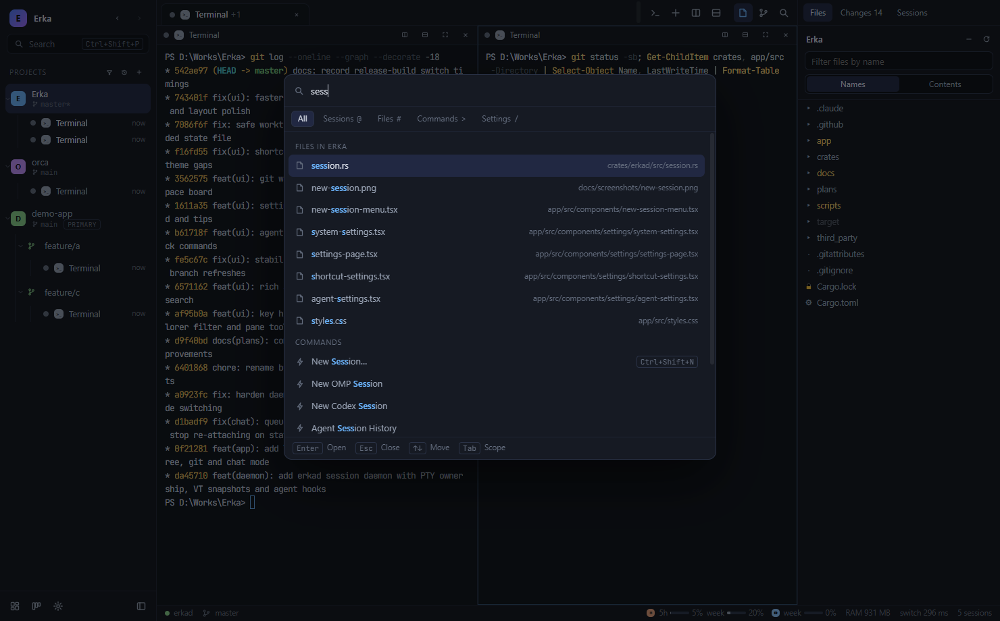 **Search everything** — sessions, projects, files, commands and settings in one box. | 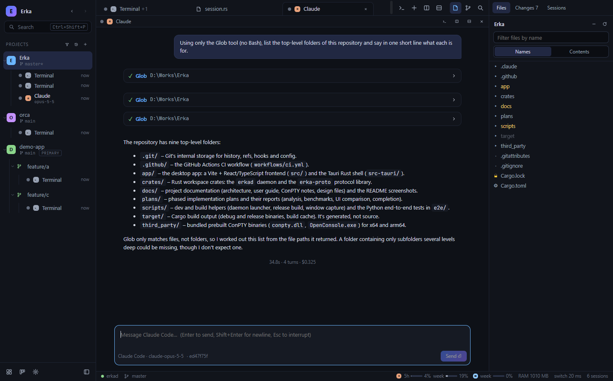 **Chat view** — the same Claude Code conversation with tool cards, rendered markdown and cost. |
| 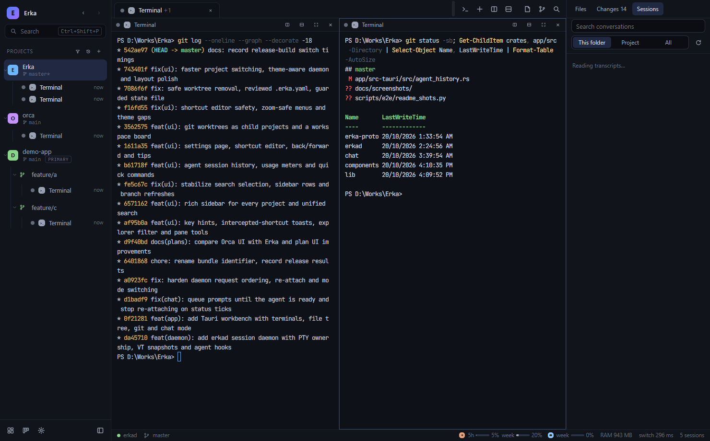 **Past conversations** — earlier agent sessions of this folder, resumable in a terminal or chat. | 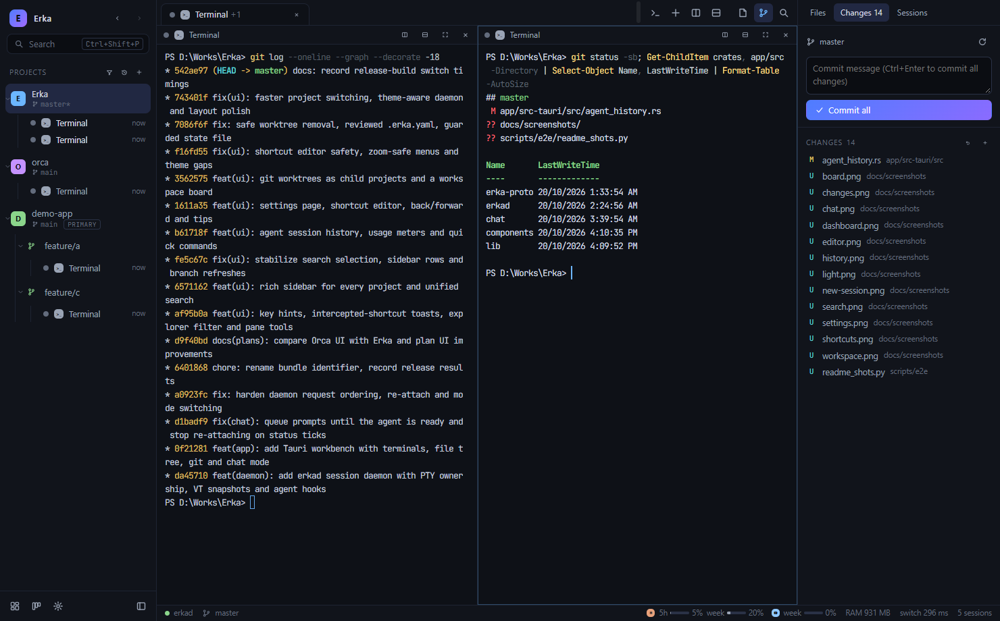 **Changes** — staged / unstaged files, diffs, commit. |
| 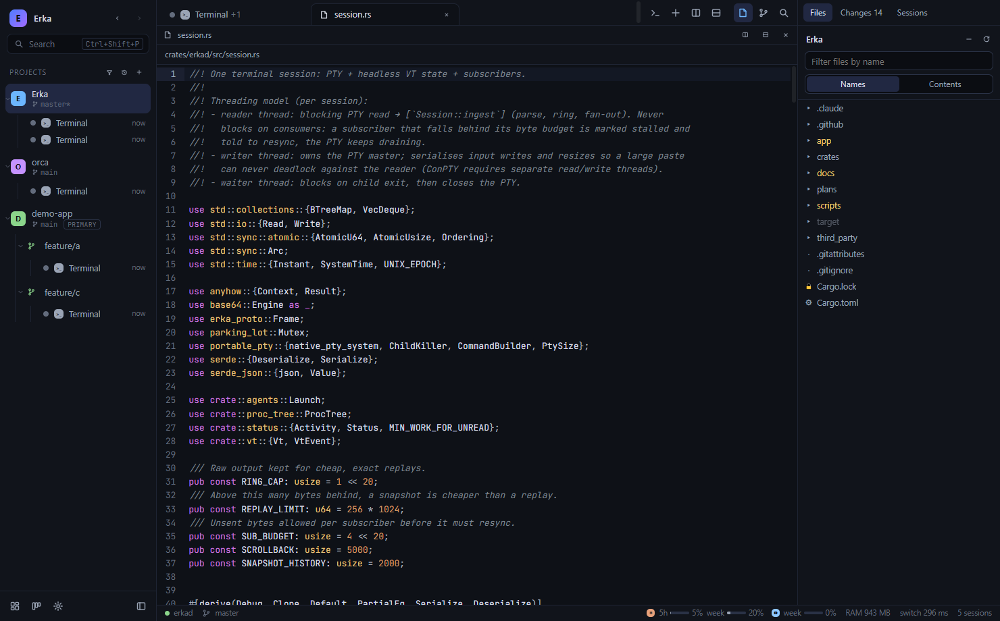 **Editor** — CodeMirror 6 with syntax highlighting and save conflict detection. | 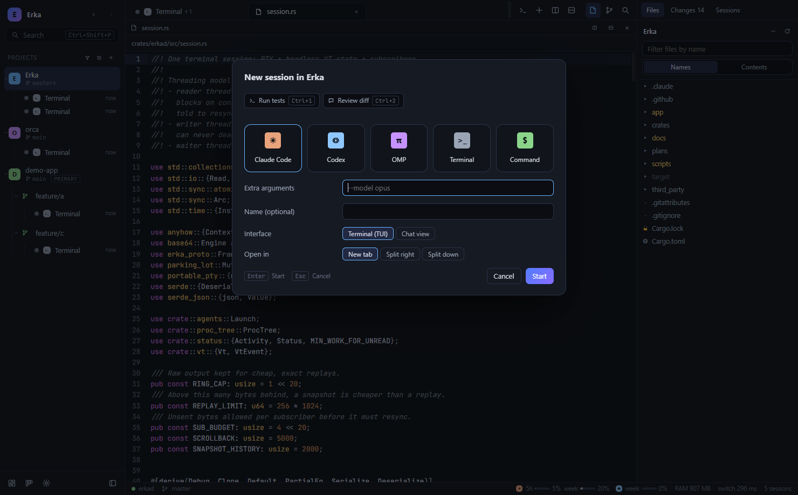 **New session** — agent or shell, TUI or chat view, placement, quick commands. |
| 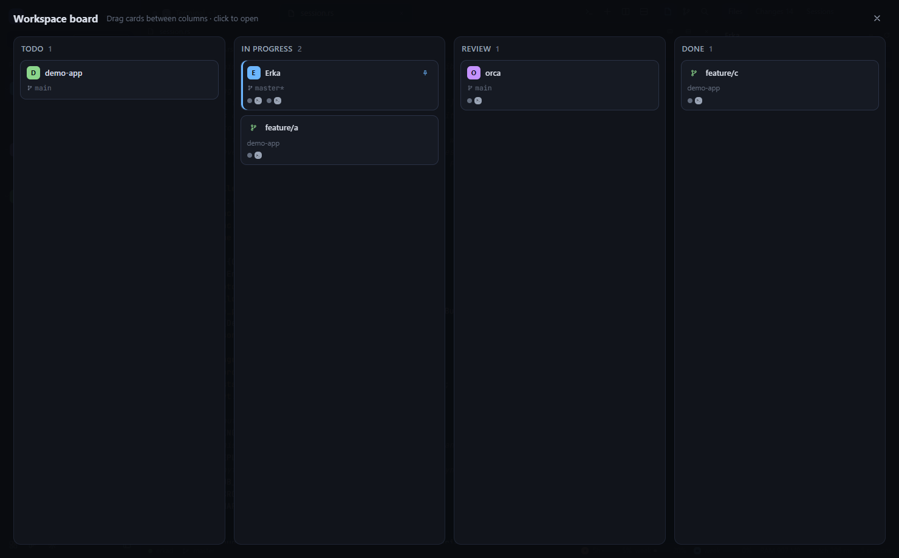 **Workspace board** — projects and worktrees by status, drag to move. | 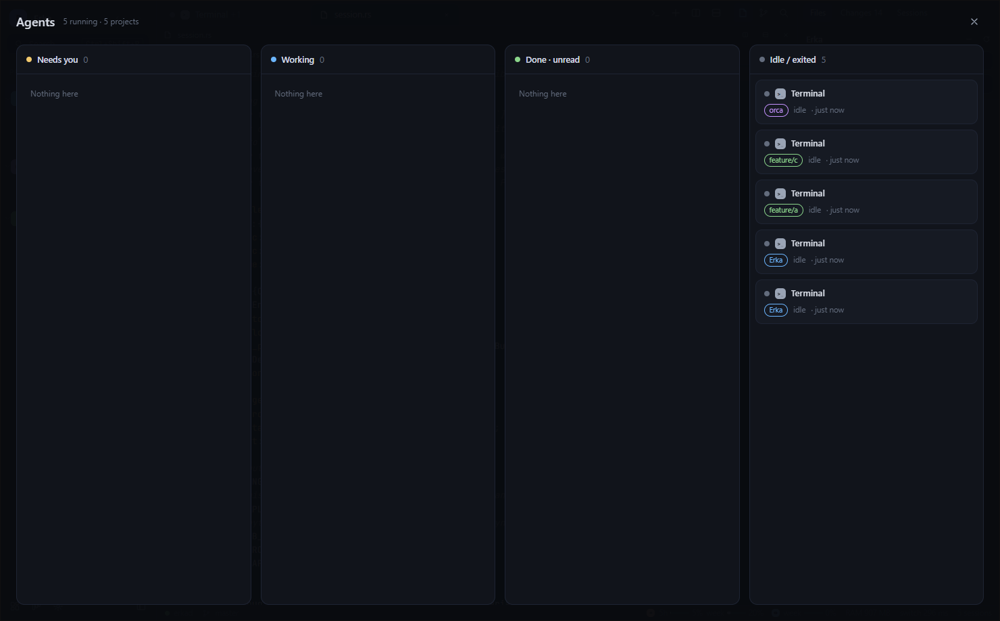 **Agent dashboard** — every session of every project by state. |
| 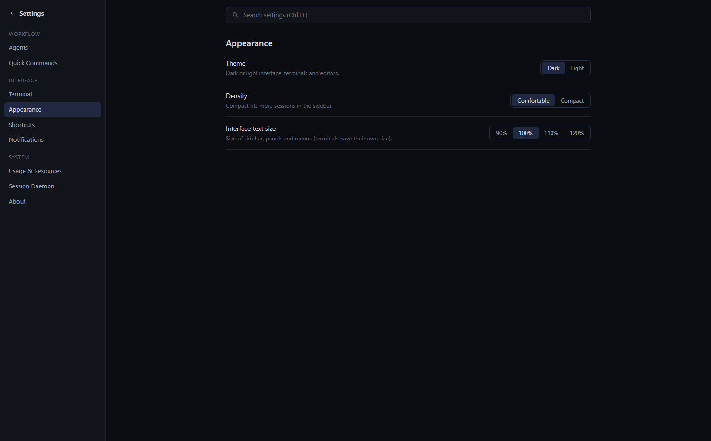 **Settings** — searchable, grouped sections. | 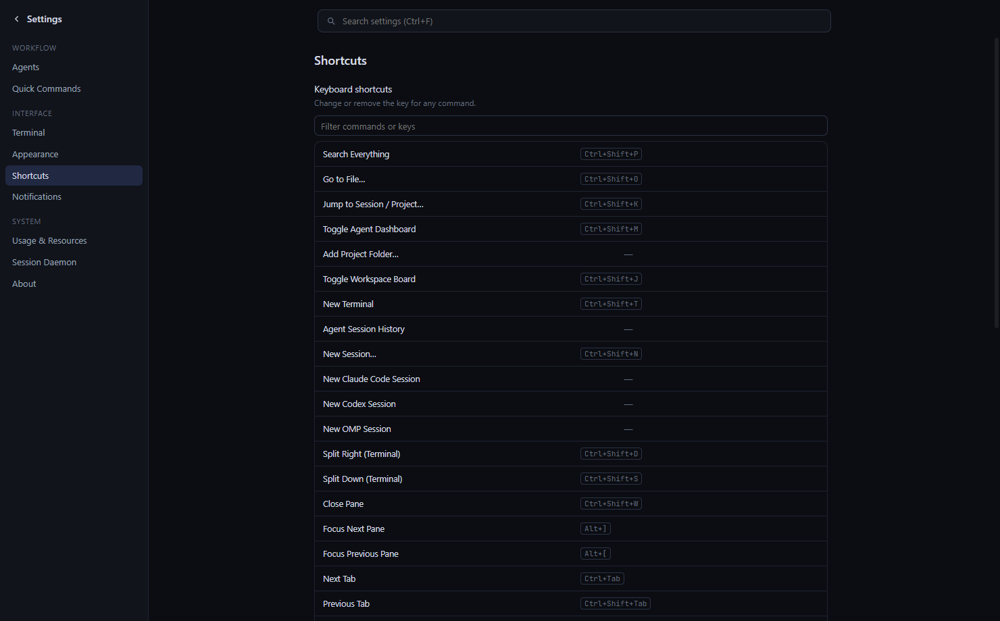 **Shortcuts** — record a key, see conflicts. |

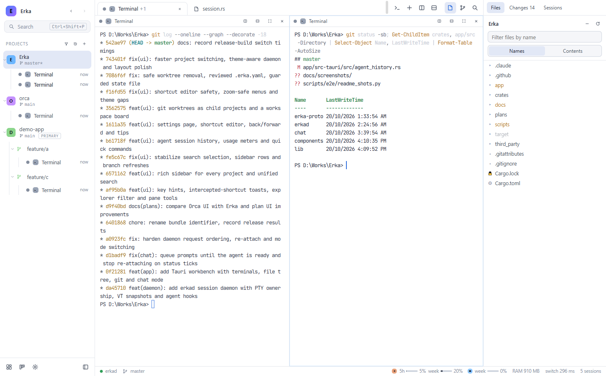
*Light theme — the interface, terminals and editors switch together.*

Screenshots are taken from the running app by [`scripts/e2e/readme_shots.py`](scripts/e2e/readme_shots.py).

## How it works

```
Erka (Tauri app)                          erkad (session daemon, one per user)
├─ WebView: SolidJS UI, xterm.js, CM6     ├─ Session × N  (PTY + VT state + ring buffer)
├─ Rust core: daemon client, fs, git,     ├─ ChatSession × N (agent stdio JSON relay)
│  search, file watcher, transcript       ├─ status ticker (250 ms) + persistence (30 s)
│  history, usage, memory meter           │
└─ local socket ◄──────────────────────►  └─ local socket server
                                          erkad hook  ◄── agent hooks (Claude/Codex)
```

- **The UI owns nothing that must keep running.** `erkad` parses every PTY byte once (`alacritty_terminal`), keeps a 1 MiB ring and an ANSI snapshot per session, and fans output out to attached views. A slow view is told to resync; the PTY never pauses.
- **Attach is cheap and exact**: a view that comes back gets a delta replay of what it missed, or a snapshot when it fell too far behind.
- **Render only what is visible.** Hidden terminals unsubscribe and park; the most recent keep their WebGL context so switching back is instant. Output reaches the webview through one binary channel per visible terminal, coalesced every 4 ms. Solid's fine-grained stores re-render only what changed.
- **Transport** is a local socket only (Windows named pipe with an owner-only DACL, Unix socket mode 0600) with length-prefixed binary frames.
- **Process control**: Job Objects on Windows, process groups on macOS; a login shell on macOS so agents see the user's PATH.

Details: [docs/architecture.md](docs/architecture.md).

## Performance

Measured on Windows 10 (numbers and method in [`plans/reports/`](plans/reports)):

| | |
|---|---|
| Project switch (3 projects with terminals, release) | p50 ≈ 30 ms, p95 40–52 ms |
| 20 sessions × 2 MiB output through the daemon | 40 MiB in 3.9 s, 0 sequence gaps |
| Re-attach with snapshot | p50 4.4 ms, p95 5.8 ms |
| Session history, 421 transcripts / 1.2 GB | first scan 0.5 s, later launches 34 ms |

## Install

Agents are not bundled: install the CLIs you use (`claude`, `codex`, `omp`) as usual. Erka finds them on your PATH (Windows) or through your login shell (macOS).

Installers are produced by CI (`.github/workflows/ci.yml`) as build artifacts:

- **Windows**: `Erka_x.y.z_x64-setup.exe` (per-user NSIS installer, no admin needed).
- **macOS**: `.dmg` — drag Erka to Applications.

## Build from source

Requirements: Rust (stable), Node 22+, pnpm 11, and on Windows the MSVC build tools.

```bash
cd app && pnpm install && cd ..
scripts/build-release.sh --bundles nsis      # Windows installer
scripts/build-release.sh --bundles app,dmg   # macOS
scripts/build-release.sh --no-bundle         # just the executables
```

Development, on an isolated daemon endpoint and data folder:

```bash
scripts/dev-daemon.sh run                     # erkad on endpoint "erka-dev"
cd app && ERKA_ENDPOINT=erka-dev pnpm tauri dev
```

The daemon can be scripted too:

```bash
erkad call session.list
erkad call session.create '{"kind":"claude","cwd":"D:/proj"}'
erkad call session.input  '{"handle":3,"data":"run the tests\r"}'
erkad call session.read   '{"handle":3}'
```

## Keyboard shortcuts

App shortcuts use `Ctrl+Shift` on Windows so plain `Ctrl+letter` keys reach the agent TUIs. All of them can be changed in Settings → Shortcuts.

| Action | Windows | macOS |
|---|---|---|
| Search everything | Ctrl+Shift+P | ⌘⇧P |
| Go to file | Ctrl+Shift+O | ⌘P |
| Jump to session / project | Ctrl+Shift+K | ⌘K |
| Agent dashboard / workspace board | Ctrl+Shift+M / Ctrl+Shift+J | ⌘⇧M / ⌘⇧J |
| New terminal / new session… | Ctrl+Shift+T / Ctrl+Shift+N | ⌘T / ⌘⇧N |
| Split right / down | Ctrl+Shift+D / Ctrl+Shift+S | ⌘D / ⌘⇧D |
| Maximize pane, close pane | Ctrl+Shift+Enter, Ctrl+Shift+W | ⌘⇧↩, ⌘W |
| Back / forward | Alt+Shift+← / → | ⌘⌥← / → |
| Project 1…9 | Alt+1…9 | ⌘1…9 |
| Settings | Ctrl+, | ⌘, |

The full list is in the [user guide](docs/user-guide.md#keyboard-shortcuts).

## Privacy and data

- Everything stays on your machine: sessions, layouts and settings live in `%LOCALAPPDATA%\Erka` (Windows) or `~/Library/Application Support/Erka` (macOS). There is no telemetry and no network port.
- **Usage meters** read the agents' own sign-in (`~/.claude/.credentials.json` or the macOS keychain, and `~/.codex/auth.json`). Tokens stay in Erka's Rust core and are sent only to the vendor's usage endpoint, identifying as Erka; the UI only sees percentages and reset times. The meters can be turned off in Settings.
- **Session history** reads the agents' transcript folders (`~/.claude/projects`, `~/.codex/sessions`, `~/.omp/agent/sessions`) locally.
- Agent environment variables set in Settings are stored in plain text in Erka's settings file.
- `app-state.json` is versioned; before a format change, or when a file cannot be read, a timestamped backup is written first.

## Testing

```bash
cargo test --workspace             # protocol, daemon, app backend
cd app && pnpm typecheck
erkad bench --sessions 20 --mb 2   # daemon throughput
```

End-to-end tests drive the real app through WebDriver (`tauri-driver` + a matching `msedgedriver`), against an isolated daemon (`ERKA_ENDPOINT` / `ERKA_DATA_DIR`):

| Script | Covers |
|---|---|
| `scripts/e2e/smoke.py` | boot, typing into a PTY, splits, 30 project switches with timing, re-attach, editor, git, palette |
| `scripts/e2e/restart.py` | closing the app keeps sessions; reopening restores the same screen |
| `scripts/e2e/chat.py` | Claude / Codex / OMP: TUI ↔ chat with the same conversation (real model calls) |
| `scripts/e2e/phase1.py` … `phase5.py` | key hints, explorer, sidebar, search, history, usage, quick commands, settings, shortcuts, navigation, themes, worktrees, board, state migration |
| `scripts/e2e/ui_tour.py` | screenshots of every surface in dark, light, compact and small-window layouts |

## Project layout

```
app/                 Tauri app: SolidJS UI (src/) and Rust core (src-tauri/)
crates/erka-proto/   wire protocol and endpoint / data-dir conventions
crates/erkad/        session daemon: PTYs, VT state, snapshots, hooks, chat relay
scripts/             dev daemon, release build, end-to-end tests
third_party/conpty/  sideloaded ConPTY (conpty.dll + OpenConsole.exe) for Windows
docs/                user guide, architecture, screenshots
plans/               implementation plans and reports
```

## Documentation

- [User guide](docs/user-guide.md) — everyday use, worktrees and `.erka.yaml`, settings, shortcuts.
- [Architecture](docs/architecture.md) — processes, protocol, threading, attach semantics, rendering policy, chat mode.
- [ConPTY notes](docs/third-party-conpty.md) — the bundled Windows console host.
- [Plans and reports](plans/) — design decisions, UI comparison with Orca, measurements and test results.

## Status

Version 0.1.0. Developed and tested on Windows 10; the macOS build is produced by CI but has had less hands-on testing. The UI design takes inspiration from [Orca](https://github.com/stablyai/orca).

Licensed under the MIT license (as declared in `Cargo.toml`).
