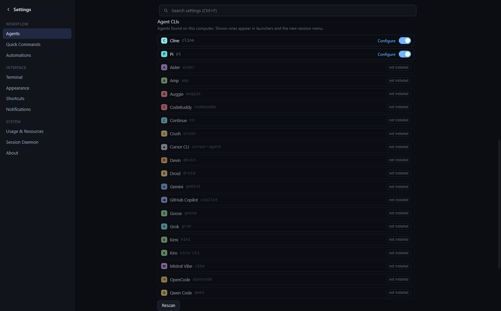
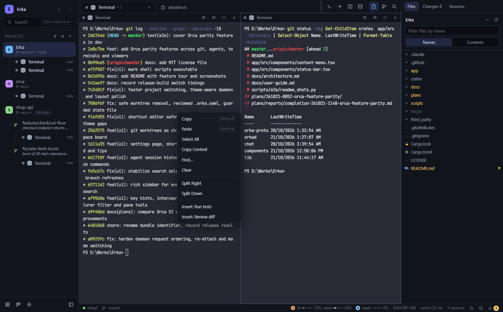
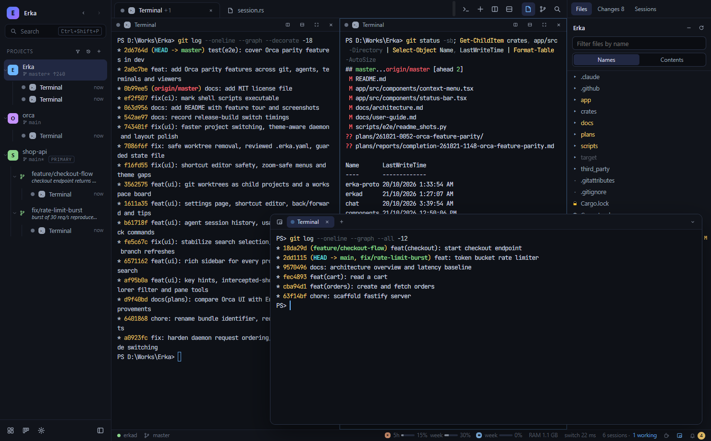
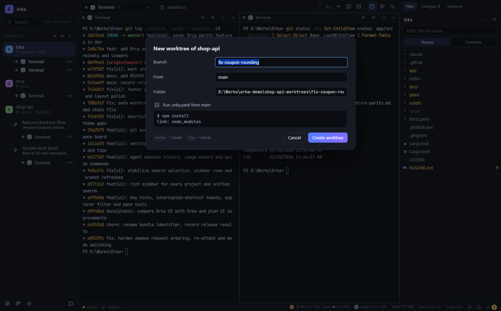
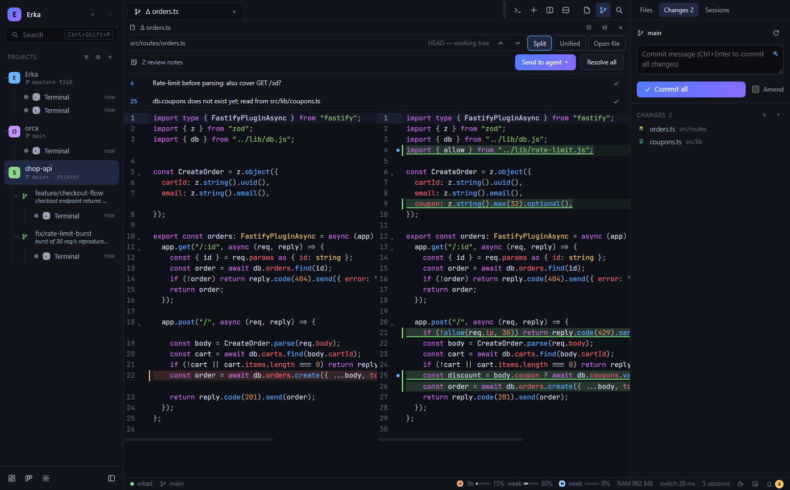
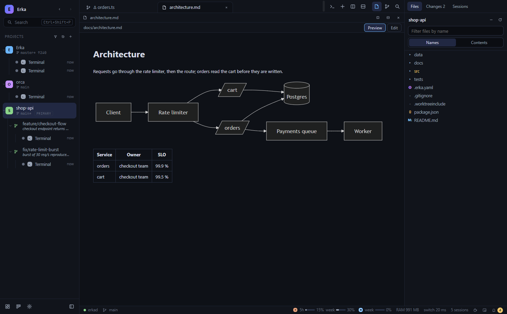
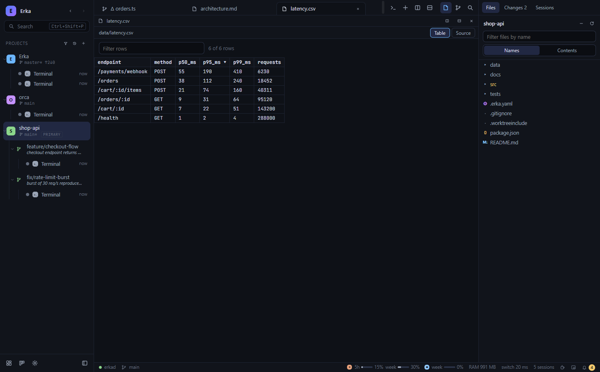
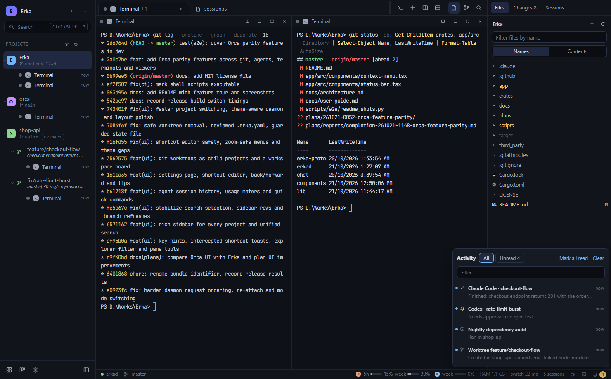
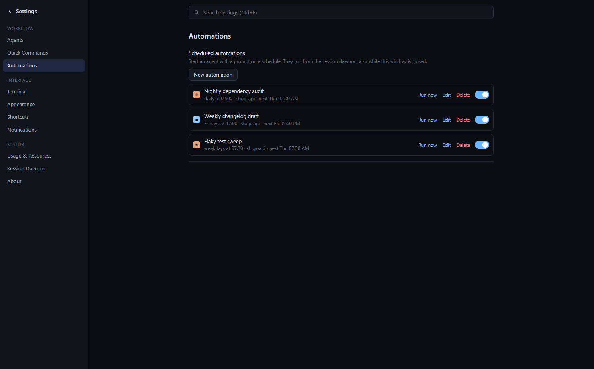

# Erka

**A fast desktop workbench for running many coding-agent CLIs — Claude Code, Codex, OMP, Gemini, Cursor, OpenCode, Copilot and 16 more, plus plain shells — across many projects at once.**

Agents live in a background session daemon, so switching projects, closing the window or a UI crash never stops them. Only what is on screen is rendered: 20 agents in the background cost the UI almost nothing, and switching between projects takes ~30 ms.


- **Windows 10 1809+ / 11** (tested) and **macOS 12+** (built in CI).
- Tauri 2 · SolidJS · xterm.js (WebGL) · CodeMirror 6 · a Rust session daemon (`erkad`) built on `alacritty_terminal` and ConPTY / Unix PTYs.

---

## Contents

- [Features](#features)
  - [Sessions and agents](#sessions-and-agents)
  - [Terminals](#terminals)
  - [Chat view and past conversations](#chat-view-and-past-conversations)
  - [Projects, worktrees and the board](#projects-worktrees-and-the-board)
  - [Source control and review](#source-control-and-review)
  - [Files, viewers and search](#files-viewers-and-search)
  - [Activity and automations](#activity-and-automations)
  - [Usage, settings and shortcuts](#usage-settings-and-shortcuts)
- [How it works](#how-it-works)
- [Performance](#performance)
- [Install](#install)
- [Build from source](#build-from-source)
- [Scripting](#scripting)
- [Keyboard shortcuts](#keyboard-shortcuts)
- [Privacy and data](#privacy-and-data)
- [Testing](#testing)
- [Project layout](#project-layout)
- [Documentation](#documentation)
- [Status](#status)

---

## Features

### Sessions and agents

- **Sessions that never stop.** Every PTY and agent process is owned by `erkad`, a per-user daemon. The window can close, crash or restart; sessions keep running and re-attach with the same screen. If the daemon itself stops, sessions come back as *exited* with their last screen and agents resume their conversation (`claude --resume`, `codex resume`, `omp --resume`, and each preset's own resume flag).
- **Live status** from hooks (Claude Code, Codex) or output activity: *working*, *needs you*, *done (unread)*, *idle* — in the sidebar, on tabs, in the dashboard, with desktop notifications for sessions you are not looking at.
- **23 agent CLIs preset**: Claude Code, Codex, OMP, Gemini, Cursor CLI, OpenCode, GitHub Copilot, Grok, Qwen Code, Droid, Aider, Amp, Goose, Kimi, Crush, Cline, Kiro, Continue, Devin, Auggie, CodeBuddy, Mistral Vibe and Pi. Erka finds the installed ones; they appear in the launchers, the others can be hidden. Arguments and environment per agent.
- **Permissions**: one *Manual / Yolo* switch adds or removes each agent's skip-permission flag; Claude Code and Codex keep their own permission mode / approval policy.
- **First prompt at launch**: type the task in the new-session menu; Erka passes it on the command line or types it once the agent is ready (long prompts are pasted).
- **Hand-off**: start another agent seeded with a bounded transcript of the current session (terminal context menu).
- **Hibernation** (opt-in): finished agents idle in background projects are stopped and resume their conversation when you show them again; *Sleep* a project or worktree on demand.
- **Keep the computer awake**: off, while agents are working, or always — from the coffee cup in the status bar.

| | |
|---|---|
|  **New session** — any installed agent or a shell, TUI or chat view, placement, first prompt, quick commands. |  **Agents** — the preset list with what is installed, shown in launchers or hidden. |
|  **Agent dashboard** — every session of every project, grouped by *needs you / working / done*. |  **Workspace board** — projects and worktrees by status, with the comment each agent left. |

### Terminals

- xterm.js with the WebGL renderer, a bundled modern ConPTY on Windows, true colour, Nerd Font glyphs, OSC 52 clipboard (only from the visible terminal), links, find, drag-and-drop of file paths.
- Splits right / down, maximize, tabs per project, keyboard focus cycling.
- **Context menu**: copy, paste, select all, *Copy Context* (the transcript, ready to paste into another agent), find, clear, split, insert a quick command, hand off to another agent.
- **Nine terminal colour themes** (Dracula, Nord, One Dark, Tokyo Night, Catppuccin Mocha, Gruvbox, Solarized dark / light, GitHub Light) on top of the dark and light app themes; the daemon's snapshots use the same palette.
- **Floating terminal**: a global shell over everything, one shortcut away (`Ctrl+Shift+`` ` / `⌘⌥A`); it keeps running when hidden.
- App shortcuts stay off the keys agent TUIs need (`Ctrl+Shift` on Windows); when Erka does keep a key from a terminal it says so once.

| | |
|---|---|
|  **Context menu** — Copy Context, splits, quick commands; here with the Dracula theme. |  **Floating terminal** — a shell above the workspace, toggled with one chord. |

### Chat view and past conversations

- Any Claude Code, Codex or OMP session can continue in a chat UI — messages, tool cards with diffs, Allow / Deny prompts, cost — and switch back to the TUI. Erka stops one front-end before starting the other, so a conversation never has two writers.
- **Past conversations**: the Sessions panel lists earlier Claude, Codex and OMP conversations from their own transcripts (this folder / project / all), searchable, resumable in a terminal or in chat view. 1.2 GB of transcripts list in 0.5 s the first time and in ~30 ms afterwards.

| | |
|---|---|
|  **Chat view** — the same Claude Code conversation with tool cards, rendered markdown and cost. |  **Past conversations** — earlier agent sessions of this folder, resumable in a terminal or chat. |

### Projects, worktrees and the board

- A sidebar with every project: branch, dirty state, ahead / behind, pull-request chip and all its sessions (status, task title, model, last activity); filter, sort, fold, pin, rename inline, *Open in* VS Code / Cursor / Zed / ….
- **Git worktrees as child projects**: create one from any local or remote branch, tag or commit with a suggested name and folder (or straight from search: type a name, pick *Create worktree*).
- **Ignored files follow the worktree**: `.worktreeinclude` and `copy:` entries are copied (`.env`), `link:` entries are shared as links (`node_modules`); the repository's `.erka.yaml` setup is shown in full and runs only when you tick it.
- Safe removal: refuses when a detached HEAD holds commits no branch has, removes shared links before the folder, and can delete the branch afterwards.
- **Worktree comments**: a line saying what the worktree is doing now, set by you or by an agent with `erkad worktree set --comment …`, shown in the sidebar and on the board.
- A workspace board (Todo / In progress / Review / Done) with drag and drop, pins and the agents running in each card.

| | |
|---|---|
|  **New worktree** — branch, start from any ref, folder, and the `.erka.yaml` it would run. |  **Search everything** — sessions, projects, files, commands and settings in one box. |

### Source control and review

- **Changes panel**: staged / unstaged files, side-by-side or unified diffs, stage, discard, commit, amend.
- **Remote**: push (publishes the branch with upstream), pull (fast-forward only), sync, and force-with-lease only as its own explicit action; a diverged branch is explained instead of failing silently.
- **Merge / rebase / cherry-pick / revert in progress** shows a banner with *Abort* and *Resolve with AI*.
- **AI helpers** (one-shot `claude -p` or `codex exec`, your own sign-in): commit message from the staged diff, *Fix with AI* when a commit hook fails.
- **GitHub pull requests** through `gh`: the branch's PR with state and checks, a sidebar chip, *Create pull request* with an AI-written title and description, *Fix broken checks*.
- **Review notes**: click a diff line, write a note, and send every note to a running or new agent as one prompt; F7 / Shift+F7 jump between changes.

| | |
|---|---|
|  **Review notes** — notes on diff lines, sent to an agent in one batch. |  **Changes** — push / pull / sync, AI commit message, amend, pull request. |

### Files, viewers and search

- File tree with ignore-aware dimming and a name filter; search in files or in one folder (*Find in Folder…* from the tree).
- A CodeMirror 6 editor with syntax highlighting, save conflict detection and word wrap (`Alt+Z`); close all editor tabs at once.
- **Rich viewers**: Markdown preview with **Mermaid** diagrams, `.mmd` diagrams with zoom, **CSV / TSV** tables (sort, filter), **PDF**, **Jupyter** notebooks (read-only) and images; the rendered ones have a *Source* toggle.
- **One search box** (`Ctrl+Shift+P`) for recent items, sessions that need you, sessions, projects, files, commands and settings; `@ # > /` narrow it down.

| | |
|---|---|
|  **Markdown + Mermaid** — diagrams render in the preview. |  **CSV table** — sortable columns and a row filter. |
|  **Editor** — CodeMirror 6 with syntax highlighting and save conflict detection. | |

### Activity and automations

- **Activity inbox** behind the bell in the status bar: agents that finished or need you, automation runs and new worktrees across every project, newest first; jump to any of them, mark read, filter. An optional sound plays with desktop notifications.
- **Scheduled automations**: an agent prompt (or shell command) in a folder every hour, day, weekday or week. The daemon runs them, also while the window is closed; *Run now*, enable / disable, and every run lands in the inbox.

| | |
|---|---|
|  **Activity** — what finished, what needs you, what ran. |  **Automations** — agent prompts on a schedule, run by the daemon. |

### Usage, settings and shortcuts

- Claude and Codex plan usage (5 h and weekly windows) and Erka's own memory use in the status bar.
- **Quick commands**: saved shell commands or agent prompts, run from search, the new-session menu or the terminal context menu.
- A searchable settings page: per-agent arguments, permission mode / approval policy and environment, terminal font, renderer and colour theme, dark and light themes, compact density, interface text size, notifications, hibernation, keep-awake.
- Every shortcut can be re-recorded; Erka warns about keys other commands, AltGr layouts or terminal programs use.

| | |
|---|---|
|  **Settings** — searchable, grouped sections. |  **Shortcuts** — record a key, see conflicts. |


*Light theme — the interface, terminals and editors switch together.*

Screenshots are taken from the running app by [`scripts/e2e/readme_shots.py`](scripts/e2e/readme_shots.py).

## How it works

```
Erka (Tauri app)                          erkad (session daemon, one per user)
├─ WebView: SolidJS UI, xterm.js, CM6     ├─ Session × N  (PTY + VT state + ring buffer)
├─ Rust core: daemon client, fs, git,     ├─ ChatSession × N (agent stdio JSON relay)
│  search, file watcher, transcript       ├─ status ticker (250 ms) + persistence (30 s)
│  history, usage, memory meter, gh       ├─ automations, keep-awake, worktree comments
└─ local socket ◄──────────────────────►  └─ local socket server
                                          erkad hook  ◄── agent hooks (Claude/Codex)
                                          erkad terminal / worktree ◄── scripts, agents
```

- **The UI owns nothing that must keep running.** `erkad` parses every PTY byte once (`alacritty_terminal`), keeps a 1 MiB ring and an ANSI snapshot per session, and fans output out to attached views. A slow view is told to resync; the PTY never pauses.
- **Attach is cheap and exact**: a view that comes back gets a delta replay of what it missed, or a snapshot when it fell too far behind.
- **Render only what is visible.** Hidden terminals unsubscribe and park; the most recent keep their WebGL context so switching back is instant. Output reaches the webview through one binary channel per visible terminal, coalesced every 4 ms. Solid's fine-grained stores re-render only what changed.
- **Transport** is a local socket only (Windows named pipe with an owner-only DACL, Unix socket mode 0600) with length-prefixed binary frames.
- **Process control**: Job Objects on Windows, process groups on macOS; a login shell on macOS so agents see the user's PATH.

Details: [docs/architecture.md](docs/architecture.md).

## Performance

Measured on Windows 10 (numbers and method in [`plans/reports/`](plans/reports)):

| | |
|---|---|
| Project switch (3 projects with terminals, release) | p50 ≈ 30 ms, p95 40–52 ms |
| 20 sessions × 2 MiB output through the daemon | 40 MiB in 3.9 s, 0 sequence gaps |
| Re-attach with snapshot | p50 4.4 ms, p95 5.8 ms |
| Session history, 421 transcripts / 1.2 GB | first scan 0.5 s, later launches 34 ms |

## Install

Agents are not bundled: install the CLIs you use (`claude`, `codex`, `gemini`, `opencode`, …) as usual. Erka finds them on your PATH (Windows) or through your login shell (macOS); Settings → Agents shows which ones it found.

Installers are produced by CI (`.github/workflows/ci.yml`) as build artifacts:

- **Windows**: `Erka_x.y.z_x64-setup.exe` (per-user NSIS installer, no admin needed).
- **macOS**: `.dmg` — drag Erka to Applications.

Optional: the GitHub CLI (`gh`, signed in) for pull requests, and VS Code / Cursor / Zed / … for *Open in*.

## Build from source

Requirements: Rust (stable), Node 22+, pnpm 11, and on Windows the MSVC build tools.

```bash
cd app && pnpm install && cd ..
scripts/build-release.sh --bundles nsis      # Windows installer
scripts/build-release.sh --bundles app,dmg   # macOS
scripts/build-release.sh --no-bundle         # just the executables
```

Development, on an isolated daemon endpoint and data folder:

```bash
scripts/dev-daemon.sh run                     # erkad on endpoint "erka-dev"
cd app && ERKA_ENDPOINT=erka-dev pnpm tauri dev
```

## Scripting

Agents and scripts can drive other sessions and report progress through the `erkad` executable:

```bash
erkad terminal list                           # sessions with handle, kind, status, folder
erkad terminal send 3 "run the tests" --enter # type into session 3
erkad terminal wait 3 --timeout-ms 600000     # until it stops working
erkad terminal read 3 --lines 80              # its last 80 lines, scrollback included
erkad worktree set --comment "fix reproduced; writing test" --status progress
erkad worktree get                            # comment and status of this worktree
```

The raw daemon API is available too:

```bash
erkad call session.list
erkad call session.create '{"kind":"claude","cwd":"D:/proj","prompt":"Summarize the open TODOs"}'
erkad call session.input  '{"handle":3,"data":"run the tests\r"}'
erkad call session.read   '{"handle":3,"lines":200}'
```

## Keyboard shortcuts

App shortcuts use `Ctrl+Shift` on Windows so plain `Ctrl+letter` keys reach the agent TUIs. All of them can be changed in Settings → Shortcuts.

| Action | Windows | macOS |
|---|---|---|
| Search everything | Ctrl+Shift+P | ⌘⇧P |
| Go to file | Ctrl+Shift+O | ⌘P |
| Jump to session / project | Ctrl+Shift+K | ⌘K |
| Agent dashboard / workspace board | Ctrl+Shift+M / Ctrl+Shift+J | ⌘⇧M / ⌘⇧J |
| New terminal / new session… | Ctrl+Shift+T / Ctrl+Shift+N | ⌘T / ⌘⇧N |
| Floating terminal | Ctrl+Shift+` | ⌘⌥A |
| Split right / down | Ctrl+Shift+D / Ctrl+Shift+S | ⌘D / ⌘⇧D |
| Maximize pane, close pane | Ctrl+Shift+Enter, Ctrl+Shift+W | ⌘⇧↩, ⌘W |
| Close all editor tabs | Ctrl+Alt+W | ⌘⌥W |
| Word wrap (editor focused) | Alt+Z | ⌥Z |
| Next / previous change in a diff | F7 / Shift+F7 | F7 / ⇧F7 |
| Back / forward | Alt+Shift+← / → | ⌘⌥← / → |
| Project 1…9 | Alt+1…9 | ⌘1…9 |
| Settings | Ctrl+, | ⌘, |

The full list is in the [user guide](docs/user-guide.md#keyboard-shortcuts).

## Privacy and data

- Everything stays on your machine: sessions, layouts, settings, worktree comments and automations live in `%LOCALAPPDATA%\Erka` (Windows) or `~/Library/Application Support/Erka` (macOS). There is no telemetry and no network port.
- **Usage meters** read the agents' own sign-in (`~/.claude/.credentials.json` or the macOS keychain, and `~/.codex/auth.json`). Tokens stay in Erka's Rust core and are sent only to the vendor's usage endpoint, identifying as Erka; the UI only sees percentages and reset times. The meters can be turned off in Settings.
- **AI helpers** (commit messages, PR text, conflict help) run your installed `claude` or `codex` CLI with your own sign-in; only the diff or context shown in the request is sent. **Pull requests** go through your `gh` login.
- **Session history** reads the agents' transcript folders (`~/.claude/projects`, `~/.codex/sessions`, `~/.omp/agent/sessions`) locally.
- Agent environment variables set in Settings are stored in plain text in Erka's settings file.
- `app-state.json` is versioned; before a format change, or when a file cannot be read, a timestamped backup is written first.

## Testing

```bash
cargo test --workspace             # protocol, daemon, app backend
cd app && pnpm typecheck
erkad bench --sessions 20 --mb 2   # daemon throughput
```

End-to-end tests drive the real app through WebDriver (`tauri-driver` + a matching `msedgedriver`), against an isolated daemon (`ERKA_ENDPOINT` / `ERKA_DATA_DIR`):

| Script | Covers |
|---|---|
| `scripts/e2e/smoke.py` | boot, typing into a PTY, splits, 30 project switches with timing, re-attach, editor, git, palette |
| `scripts/e2e/restart.py` | closing the app keeps sessions; reopening restores the same screen |
| `scripts/e2e/chat.py` | Claude / Codex / OMP: TUI ↔ chat with the same conversation (real model calls) |
| `scripts/e2e/phase1.py` … `phase5.py` | key hints, explorer, sidebar, search, history, usage, quick commands, settings, shortcuts, navigation, themes, worktrees, board, state migration |
| `scripts/e2e/parity.py` | agent presets and Yolo, startup prompts, `erkad terminal` / `worktree` CLI, push / pull / sync / abort, worktree copy / link, review notes, inbox, floating terminal, hibernation, keep-awake, themes, viewers, automations (`--ai`: one real one-shot call) |
| `scripts/e2e/ui_tour.py` | screenshots of every surface in dark, light, compact and small-window layouts |
| `scripts/e2e/readme_shots.py` | the screenshots in this README, from a demo repository |

## Project layout

```
app/                 Tauri app: SolidJS UI (src/) and Rust core (src-tauri/)
crates/erka-proto/   wire protocol and endpoint / data-dir conventions
crates/erkad/        session daemon: PTYs, VT state, snapshots, hooks, chat relay,
                     automations, keep-awake, worktree comments, terminal CLI
scripts/             dev daemon, release build, end-to-end tests
third_party/conpty/  sideloaded ConPTY (conpty.dll + OpenConsole.exe) for Windows
docs/                user guide, architecture, screenshots
plans/               implementation plans and reports
```

## Documentation

- [User guide](docs/user-guide.md) — everyday use, agents, terminals, worktrees and `.erka.yaml`, source control and review, viewers, automations, settings, shortcuts.
- [Architecture](docs/architecture.md) — processes, protocol, threading, attach semantics, rendering policy, chat mode, daemon services.
- [ConPTY notes](docs/third-party-conpty.md) — the bundled Windows console host.
- [Plans and reports](plans/) — design decisions, UI and feature comparisons with Orca, measurements and test results.

## Status

Version 0.1.0. Developed and tested on Windows 10; the macOS build is produced by CI but has had less hands-on testing. The UI design and feature set take inspiration from [Orca](https://github.com/stablyai/orca).

Licensed under the [MIT license](LICENSE). The bundled ConPTY binaries in `third_party/conpty` are Microsoft's, also MIT — see [docs/third-party-conpty.md](docs/third-party-conpty.md).
